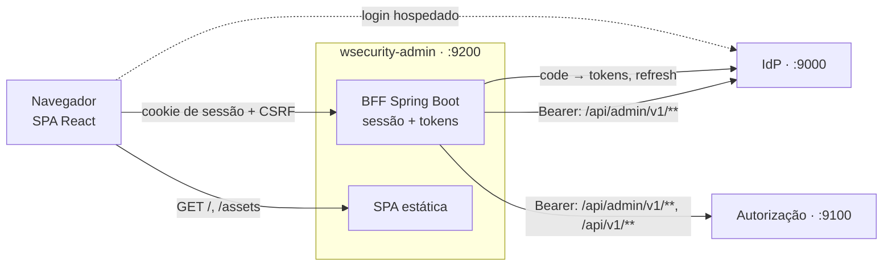

# wsecurity-admin

Console de administração do **wsecurity**. Pelo navegador, o administrador da plataforma gerencia o IdP (usuários,
clientes, escopos e chaves) e a autorização (catálogo, papéis globais, tenants, chaves e auditoria). O dono ou
administrador de um tenant gerencia os próprios membros, papéis e auditoria.

> Estado: **fase 0004, prompt 09 (tenants da plataforma)**. Login, sessão, proxy e o esqueleto da SPA (layout, rotas por contexto,
> padrões de tela) funcionam; as telas de cada área entram nos próximos prompts ([`wsecurity-docs/prompts/0004-admin-console`](../../wsecurity-docs/prompts/0004-admin-console/README.md)).

## Arquitetura

Padrão **BFF** (*backend-for-frontend*, DEC-01): o Spring Boot é o cliente OAuth confidencial, guarda os tokens na
sessão do servidor e repassa as chamadas da SPA às APIs. O navegador só recebe um cookie de sessão `HttpOnly`. A SPA
React é construída pelo Maven e servida pelo próprio BFF, na mesma origem (DEC-02, DEC-10).



## Pré-requisitos

1. [asdf](https://asdf-vm.com/) com os plugins `java`, `maven` e `nodejs`.
2. `asdf install` na raiz deste módulo. O `.tool-versions` fixa Java (openjdk-25.0.2), Maven (3.9.11) e Node
   (24.21.0 LTS, com npm 11.19.0). Daí vêm o Java da IDE e do `./mvnw` e o Node de `npm run dev`. Não use nvm nem Node/JDK
   instalados de outra forma.
3. Docker, para a imagem e para o ambiente local (`code/wsecurity-infra`).

O build pelo Maven não depende do Node da máquina: o `frontend-maven-plugin` baixa a mesma versão do Node em
`frontend/node`.

## Como construir

```bash
asdf install
./mvnw verify                    # SPA (npm ci, lint, testes, build) + BFF (testes, Spotless, ArchUnit, JaCoCo)
./mvnw verify -Dskip.frontend    # só o BFF
docker build -t wsecurity-admin .
```

## Como rodar

### Com o resto do sistema (Compose)

O console faz parte do ambiente local do [`wsecurity-infra`](../wsecurity-infra/README.md):

```bash
cd ../wsecurity-infra
make up-app        # banco, Mailpit, IdP, autorização e o console em http://localhost:9200
```

`make up-app` cadastra no IdP os dois clientes do console (`make configurar-idp`) e entrega as credenciais ao
contêiner por `.local/console-admin.env`.

### Na IDE

Suba o resto do sistema sem o console e rode o BFF no perfil `dev`. Os padrões desse perfil já apontam para o IdP em
`http://localhost:9000` e para a autorização em `http://localhost:9100`. As credenciais dos clientes vêm do arquivo
gerado pelo `wsecurity-infra`:

```bash
(cd ../wsecurity-infra && make up-app SEM_ADMIN=sim)    # ou, com o console no ar: make down-admin
set -a; source ../wsecurity-infra/.local/console-admin.env; set +a
java -jar target/wsecurity-admin-*.jar --spring.profiles.active=dev
# http://localhost:9200/            → SPA
# http://localhost:9201/actuator/health
```

Na IDE, carregue o mesmo arquivo nas variáveis de ambiente da configuração de execução (no IntelliJ, "Environment
variables" → arquivo `.env`, ou um plugin de EnvFile) e use o perfil `dev`.

Para desenvolver a SPA com recarga automática: `cd frontend && npm run dev` (Vite em `http://localhost:5174`).

## Versões fixadas

| Componente | Versão |
|------------|--------|
| Java / Spring Boot / Spring Security | 25 / 4.1.1 / 7.1 |
| Node / npm | 24.21.0 / 11.19.0 |
| React / React Router / TanStack Query | 19.3.0 / 8.4.0 / 5.104.2 |
| TypeScript / Vite / Vitest | 6.0.3 / 8.3.4 / 5.0.4 |
| Tailwind CSS / ESLint / Prettier | 4.3.3 / 10.12.0 / 3.9.10 |

As versões do `package.json` são exatas (sem `^`/`~`, RNF-TEC-03). A lista completa está em `frontend/package.json` e
no `pom.xml`.

## Configuração

Propriedades `wsecurity.admin.*` e variáveis `WSECURITY_ADMIN_*` (especificação, 04 §5):

| Variável | Padrão `dev` | Descrição |
|----------|--------------|-----------|
| `WSECURITY_ADMIN_IDP_ISSUER` | `http://localhost:9000` | `iss` esperado; base dos endpoints do IdP vistos pelo navegador |
| `WSECURITY_ADMIN_IDP_INTERNAL_URI` | o emissor | Base do IdP usada pelo BFF (no Compose: `http://authentication:9000`) |
| `WSECURITY_ADMIN_AUTHZ_URI` | `http://localhost:9100` | API da autorização (no Compose: `http://authorization:9100`) |
| `WSECURITY_ADMIN_CLIENT_ID` / `_SECRET` | — | Cliente do console (`.local/console-admin.env`) |
| `WSECURITY_ADMIN_SERVICE_CLIENT_ID` / `_SECRET` | — | Cliente de serviço do console (opcional) |
| `WSECURITY_ADMIN_PUBLIC_URI` | `http://localhost:9200` | Endereço público do console |
| `WSECURITY_ADMIN_SESSION_IDLE_TIMEOUT` / `_MAX_AGE` | `30m` / `12h` | Sessão do console |
| `WSECURITY_ADMIN_PROXY_CONNECT_TIMEOUT` / `_READ_TIMEOUT` | `2s` / `10s` | Tempos limite do BFF para as APIs |
| `WSECURITY_ADMIN_PORT` / `WSECURITY_ADMIN_MANAGEMENT_PORT` | `9200` / `9201` | Portas da aplicação e do Actuator |

Fora do perfil `dev` não há padrões para os endereços. No perfil `prod`, a subida
falha se faltarem `WSECURITY_ADMIN_IDP_ISSUER`, `WSECURITY_ADMIN_PUBLIC_URI`, `WSECURITY_ADMIN_CLIENT_ID` ou
`WSECURITY_ADMIN_CLIENT_SECRET`.

## Login e sessão

- **Login:** qualquer página sem sessão leva ao login hospedado do IdP pelo registro `wsecurity`
  (`openid profile email wsecurity.admin`, `authorization_code` + PKCE, cliente confidencial). Se o IdP recusar
  `wsecurity.admin` (`invalid_scope`, usuário que não é administrador), o BFF refaz a autorização uma vez pelo registro
  `wsecurity-basic`, sem esse escopo. A sessão do IdP já existe, então a senha não é pedida de novo (DEC-03).
- **Endereços do IdP (DEC-08):** o navegador vai a `WSECURITY_ADMIN_IDP_ISSUER` (autorização e logout). O BFF usa
  `WSECURITY_ADMIN_IDP_INTERNAL_URI` (token, JWKS, userinfo e revogação). O `iss` do ID token precisa ser o emissor.
- **Sessão:** fica em memória no servidor, com os tokens (DEC-06, RN-01). O navegador recebe só o cookie `HttpOnly`
  `WSADMIN_SESSION` (`__Host-WSADMIN_SESSION` com `Secure` fora de `dev`), com `SameSite=Lax`. A sessão expira após
  30 min sem uso ou 12 h desde o login. O access token é renovado com o refresh token quando faltam menos de 30 s para
  expirar. Se a renovação falhar, a sessão termina e a chamada responde `401` (`…/session-expired`).
- **`GET /bff/session`:** `sub`, `name`, `email`, `platformAdmin` (escopo `wsecurity.admin`), `mfa` (`amr` com `otp`),
  `expiresAt` e os tenants com alguma permissão `core.*` (`/api/v1/me/**` da autorização). `tenantsAvailable: false`
  indica que a autorização não respondeu.
- **Logout:** `POST /bff/logout` com CSRF revoga o refresh token, invalida a sessão e leva ao `/connect/logout` do IdP,
  que volta à página inicial do console. A SPA chama com `fetch` e recebe `{"redirectUrl": …}` (DEC-14).
- **Páginas do BFF:** `/login-error` (erro no retorno do login) e `/no-access` (sem administração da plataforma nem
  tenants administráveis).

## Segurança

| Item | Como |
|------|------|
| Tokens | Só na sessão do servidor; nenhuma resposta, cookie legível ou armazenamento do navegador os contém. |
| CSRF | Modo SPA do Spring Security: cookie `XSRF-TOKEN` legível pela SPA e cabeçalho `X-XSRF-TOKEN` em toda requisição que altera estado. |
| CSP | `default-src 'self'; script-src 'self'; style-src 'self'; img-src 'self' data:; connect-src 'self'; frame-ancestors 'none'; base-uri 'self'; form-action 'self' <IdP>`, sem `unsafe-inline`. O CSS do sonner é importado como arquivo e a injeção de `<style>` é desligada no build. |
| Outros cabeçalhos | `X-Content-Type-Options: nosniff`, `Referrer-Policy: no-referrer`, `Permissions-Policy` mínima, `Cross-Origin-Opener-Policy: same-origin`, HSTS fora de `dev` (em HTTPS). |
| Cache | `no-store` em `/bff/**` e no `index.html`; *assets* com *hash* têm cache de 1 ano (`immutable`). |
| Cabeçalhos encaminhados | `X-Forwarded-*` só são aceitos em `dev`, para o proxy do Vite. |

## Solução de problemas

| Sintoma | Causa provável e solução |
|---------|--------------------------|
| A aplicação não sobe: "Configure o cliente do console" | Faltam `WSECURITY_ADMIN_CLIENT_ID`/`_SECRET`. Carregue `../wsecurity-infra/.local/console-admin.env` (veja "Na IDE"). |
| O IdP mostra erro de `redirect_uri` | O cliente do console não tem a origem usada (porta do console ou 5174). Rode `make configurar-idp` no `wsecurity-infra`. |
| Login volta para `/login-error` | O `iss` do ID token não é `WSECURITY_ADMIN_IDP_ISSUER`, ou o IdP recusou o login. Confira o emissor e os logs do console. |
| `POST` responde `403` | Falta o cabeçalho `X-XSRF-TOKEN` com o valor do cookie `XSRF-TOKEN`. |

## Proxy das APIs

A SPA chama as APIs só pelo BFF, na mesma origem. O proxy repassa **apenas** as rotas de 04 §3.2 da especificação
(`ProxyRoutes`, conferida contra a tabela por `ProxyRoutesSpecificationTest`):

| Rota no console | Destino |
|-----------------|---------|
| `/bff/api/idp/**` | `${IDP}/api/admin/v1/**` (todas exigem `wsecurity.admin`) |
| `/bff/api/authz/admin/**` | `${AZ}/api/admin/**` (exigem `wsecurity.admin`) |
| `/bff/api/authz/v1/**` | `${AZ}/api/v1/**` (área do tenant: a autorização decide) |
| `GET /bff/users/{sub}/access` | tenants, papéis e permissões de um usuário, pelo cliente de serviço (`wsecurity.authz`); só para `wsecurity.admin` |

- **Cabeçalhos:** entram só `Content-Type`, `Accept`, `If-Match` e `If-None-Match`, mais o `Authorization` com o token
  da sessão (renovado se preciso). Saem só `Content-Type`, `ETag`, `Location` (reescrito para `/bff/api/...`) e
  paginação. `Cookie`, `Set-Cookie` e qualquer outro cabeçalho são descartados nos dois sentidos.
- **Recusas sem chamar a API:** rota fora da lista → `404`; rota da plataforma sem `wsecurity.admin` → `403`;
  caminho com `..`, `//`, `;`, `\` ou `%2F`/`%5C`/`%2E`/`%25` → `400`; corpo acima de 1 MiB → `413`.
- **Erros:** os Problem Details das APIs passam sem alteração; falha de conexão → `502` (`…/upstream-unavailable`);
  tempo esgotado (10 s, `WSECURITY_ADMIN_PROXY_READ_TIMEOUT`) → `504` (`…/upstream-timeout`).
- **Registro de acesso:** cada escrita (`POST`, `PUT`, `PATCH`, `DELETE`) gera um log com `sub`, método, rota, status
  e duração, sem corpo, token ou cookie (logger `dev.wmaduro.wsecurity.admin.proxy.access`).
- **Acessos do usuário:** sem `WSECURITY_ADMIN_SERVICE_CLIENT_ID`/`_SECRET`, `GET /bff/users/{sub}/access` responde
  `503`. O token do cliente de serviço fica só em memória no servidor e não é usado em nenhuma outra rota.

### Latência do proxy (RNF-DES-01)

`scripts/medir-proxy.sh` compara `GET /bff/api/authz/admin/v1/tenants` pelo console com a chamada direta à
autorização. Medição de 2026-10-12, ambiente local (`make up-app`, perfil `dev`), 300 requisições sequenciais por lado:

| | p50 | p95 |
|---|---|---|
| Direto na autorização | 3,8 ms | 5,6 ms |
| Pelo BFF | 8,9 ms | 14,1 ms |
| **Acréscimo do BFF (p95)** | | **8,5 ms** (limite: 20 ms) |

```bash
TOKEN=$(cd ../wsecurity-infra && make -s token-admin) COOKIES=<cookie jar com a sessão> ./scripts/medir-proxy.sh
```

## SPA

Estrutura (`frontend/src`, RNF-ARQ-03):

| Pasta | Conteúdo |
|-------|----------|
| `routes/` | Rotas do React Router: `/platform/**` (exige `wsecurity.admin`) e `/t/:slug/**` (exige o tenant na sessão ou `wsecurity.admin`), páginas 403 e 404 e a página inicial de RF-NAV-03. Cada área é carregada sob demanda. |
| `features/<área>/` | Telas de cada área (`users`, `clients`, `catalog`, `roles`, `tenants`, `tenant`, `platform`, `home`). Uma área só usa a API pública (`index.ts`) de outra; o ESLint barra importações de arquivos internos. A matriz de permissões (`PermissionMatrix`) é exportada pela área `roles`. |
| `components/` | Padrões de tela: `DataTable` (paginação no servidor; busca, filtros e ordenação na URL), `FormField` e `applyApiErrors` (erros da API no campo), `ConfirmDialog` (com confirmação forte), `showProblem` (notificação com `title`, `detail` e `traceId`), `ConflictNotice` (`409`/`412`), `PermissionGate`, `DateTime`, `StatusBadge` e `CopyOnceSecret`. O layout fica em `components/layout`. |
| `components/ui/` | Componentes no estilo shadcn/ui. Diálogo e seleção são nativos (`<dialog>`, `<select>`), porque os do Radix injetam `<style>` e quebrariam a CSP (DEC-15). |
| `lib/` | Cliente HTTP (`lib/api`: `idp.*` e `authz.*` tipados pelos contratos, CSRF, `If-Match`, `ApiError`), sessão (`useSession`, `can`, `isPlatformAdmin`), preferências de interface e formatação. |

- **Contratos:** os tipos das APIs vêm de `frontend/openapi/*.json` (`npm run openapi:update`; veja o README da pasta).
- **Sessão:** a SPA lê `/bff/session`. Sem acesso administrativo, vai para `/no-access`. Um `401` em qualquer chamada
  mostra "Sua sessão expirou"; "entrar de novo" recarrega a página, e o BFF faz o login e volta para a mesma tela.
- **Armazenamento:** só preferências de interface (menu recolhido, tamanho de página) em `localStorage`; nada de
  sessão, token ou resposta de API.
- **Pacote inicial:** o build falha se o pacote inicial passar de 300 KiB gzip (`scripts/check-bundle.mjs`). Na
  medição de 2026-10-12, ele tinha 135 KiB.
