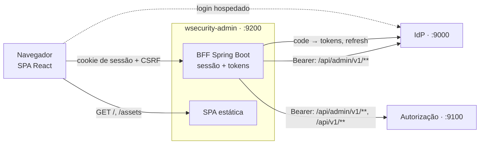

# wsecurity-admin

Console de administração do **wsecurity**. Pelo navegador, o administrador da plataforma gerencia o IdP (usuários,
clientes, escopos e chaves) e a autorização (catálogo, papéis globais, tenants, chaves e auditoria). O dono ou
administrador de um tenant gerencia os próprios membros, papéis e auditoria.

> Estado: **fase 0004, prompt 01 (setup)**. O BFF sobe e serve uma SPA provisória. Login, proxy e telas entram nos
> próximos prompts ([`wsecurity-docs/prompts/0004-admin-console`](../../wsecurity-docs/prompts/0004-admin-console/README.md)).

## Arquitetura

Padrão **BFF** (*backend-for-frontend*, DEC-01): o Spring Boot é o cliente OAuth confidencial, guarda os tokens na
sessão do servidor e repassa as chamadas da SPA às APIs. O navegador só recebe um cookie de sessão `HttpOnly`. A SPA
React é construída pelo Maven e servida pelo próprio BFF, na mesma origem (DEC-02, DEC-10).



## Pré-requisitos

1. [asdf](https://asdf-vm.com/) com os plugins `java`, `maven` e `nodejs`.
2. `asdf install` na raiz deste módulo. O `.tool-versions` fixa Java (openjdk-25.0.2), Maven (3.9.11) e Node
   (24.21.0 LTS, com npm 11.19.0). Daí vêm o Java da IDE e do `./mvnw` e o Node de `npm run dev`. Não use nvm nem Node/JDK
   instalados de outra forma.
3. Docker, para a imagem e para o ambiente local (`code/wsecurity-infra`).

O build pelo Maven não depende do Node da máquina: o `frontend-maven-plugin` baixa a mesma versão do Node em
`frontend/node`.

## Como construir

```bash
asdf install
./mvnw verify                    # SPA (npm ci, lint, testes, build) + BFF (testes, Spotless, ArchUnit, JaCoCo)
./mvnw verify -Dskip.frontend    # só o BFF
docker build -t wsecurity-admin .
```

Para rodar localmente no perfil `dev`:

```bash
java -jar target/wsecurity-admin-*.jar --spring.profiles.active=dev
# http://localhost:9200/            → SPA
# http://localhost:9201/actuator/health
```

Para desenvolver a SPA com recarga automática: `cd frontend && npm run dev` (Vite em `http://localhost:5174`).

## Versões fixadas

| Componente | Versão |
|------------|--------|
| Java / Spring Boot / Spring Security | 25 / 4.1.1 / 7.1 |
| Node / npm | 24.21.0 / 11.19.0 |
| React / React Router / TanStack Query | 19.3.0 / 8.4.0 / 5.104.2 |
| TypeScript / Vite / Vitest | 6.0.3 / 8.3.4 / 5.0.4 |
| Tailwind CSS / ESLint / Prettier | 4.3.3 / 10.12.0 / 3.9.10 |

As versões do `package.json` são exatas (sem `^`/`~`, RNF-TEC-03). A lista completa está em `frontend/package.json` e
no `pom.xml`.

## Configuração

Propriedades `wsecurity.admin.*` e variáveis `WSECURITY_ADMIN_*` (especificação, 04 §5). No perfil `prod`, a subida
falha se faltarem `WSECURITY_ADMIN_IDP_ISSUER`, `WSECURITY_ADMIN_PUBLIC_URI`, `WSECURITY_ADMIN_CLIENT_ID` ou
`WSECURITY_ADMIN_CLIENT_SECRET`.
